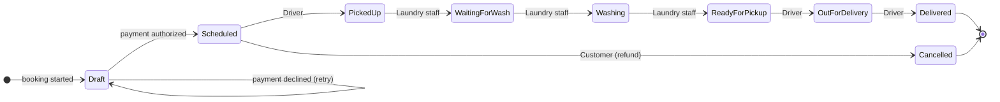

# ZippyWash — Order & Operations Prototype

**▶ Try it live: https://zippywash-team5.streamlit.app** (no sign-up; if it says the app is asleep, click *Wake up* and wait ~30 s)

ZippyWash is a Montréal laundry pickup-and-delivery service. This is the first working prototype
of its order system, built by **BTM 495 Team 5** (Concordia University, John Molson School of Business,
Fall 2026) from our Milestone 3 UML class diagram.

> All people, addresses, cards and prices are **sample data**. No real payments are made.

| | |
|---|---|
| Milestone 3 model version | Final, October 26, 2026 |
| Prototype version | 1.0 |
| Implemented workflows | UC01, UC02, UC05 and UC06 |
| Model classes represented | C01–C26 (all 26 finalized Milestone 3 classes) |

---

## Try it in 2 minutes

| Step | Do this | You'll see |
|---|---|---|
| 1 | As customer **Léa**, open **Book a pickup**. Pick a service, bag size and times. Enter promo `WELCOME10`. | Live price with promo, delivery fee, GST and QST |
| 2 | Pay with **Mastercard ending 0002** | Declined on purpose. The order is not booked. |
| 3 | Retry with **Visa ending 4242** | Booked, with a receipt number |
| 4 | Open **My orders** | Your order, its receipt and a status timeline |
| 5 | Sidebar → **Staff → Sofia Haddad (Laundry)** | "Mark Picked Up" is disabled: only drivers record pickups |
| 6 | Sidebar → **Staff → Marc Gagnon (Driver)** → mark it *Picked Up* | The status moves one step |
| 7 | Back to **Léa** → *My orders* and *Profile* | Timeline updated, cancel button gone, notification received |

Everyone using the live link shares one database. *Reset demo data* in the sidebar restores the original sample data.

---

## What's covered

| Use case | In this prototype |
|---|---|
| **UC-01** Book Pickup & Delivery | Service, bag size, pickup and delivery address, time slots, confirmation |
| **UC-02** Track & Update Order Status | Customer timeline and history; drivers and laundry staff update status |
| **UC-05** Calculate Price & Process Online Payment | Price breakdown, promo codes, online authorization, declined-card retry, receipt, refund on cancel |
| **UC-06** Manage Customer Profile & Order History | Edit profile and service preferences, add addresses (with access instructions and service-area check), payment methods, order history, notifications |
| UC-03, UC-04, UC-07 | Functionality planned for Prototype 2. Their classes, attributes, tables and sample data already exist; full interfaces are not part of this submission. |

---

## How it's built


- **Domain classes** are the 26 classes of the finalized Milestone 3 class diagram. The prototype represents
  the 26 finalized Milestone 3 analysis classes, C01–C26. The abstract `Person` class (C26) is implemented through
  Python inheritance (`Customer` and `StaffMember` inherit `name` and `contact_details`) and does not need a separate
  database table. Additional relational tables implement multivalued attributes and associations
  (`staff_roles`, `order_item_add_ons`).
- Operations used by the working screens are implemented as methods, e.g. `Order.calculate_estimate()`,
  `Order.calculate_final_total()`, `Order.confirm()`, `Order.update_status()`, `Order.cancel()`,
  `OrderItem.calculate_line_total()`, `TimeSlot.reserve_capacity()`, `Payment.create_attempt()`,
  `Payment.authorize()`, `Payment.refund()`, `Address.assign_sector()`, `StaffMember.check_authorization()`.
  Classes for UC-03, UC-04 and UC-07 hold all their attributes and a few simple methods; methods are optional
  for this prototype.
- **Services** only coordinate the classes in the right order. They hold no business rules.
- **The UI** only collects input and shows results.
- **The database** is storage behind a repository, not a class in the domain model.
- `Repository`, the services, `PaymentProcessor`/`MockPaymentProcessor`, `BookingResult` and `PriceBreakdown` are
  implementation classes. They are not Milestone 3 problem-domain classes.

### Order lifecycle



### Folder map

```
app.py                                Streamlit screens (customer + staff)
zippywash/
  person.py                           C26 Person (abstract superclass of Customer and StaffMember)
  common.py                           Enumerations (OrderStatus, PickupRequestType, AddOnType, ...) and helpers
  config.py                           Prices, fees and tax rates (one place to change them)
  customer_order_service/
    customer.py                       C01 Customer
    address.py                        C02 Address
    service_type.py                   C03 ServiceType
    time_slot.py                      C04 TimeSlot
    loyalty_account.py                C05 LoyaltyAccount
    order.py                          C06 Order (+ PriceBreakdown value object)
    order_status_update.py            C07 OrderStatusUpdate
    notification.py                   C08 Notification
    loyalty_rule.py                   C09 LoyaltyRule
    loyalty_transaction.py            C10 LoyaltyTransaction
    payment.py                        C11 Payment
    payment_method.py                 C12 PaymentMethod
    reward.py                         C13 Reward
    promotion.py                      C14 Promotion
    order_item.py                     C23 OrderItem
  operations_resource/
    sector.py                         C15 Sector
    staff_member.py                   C16 StaffMember
    route.py                          C17 Route
    route_stop.py                     C18 RouteStop
    machine.py                        C19 Machine
    maintenance_record.py             C20 MaintenanceRecord
    inventory_item.py                 C21 InventoryItem
    stock_movement.py                 C22 StockMovement
    vehicle.py                        C24 Vehicle
    staff_shift.py                    C25 StaffShift
  services/                           BookingService · OrderTrackingService · CustomerProfileService
  integrations/payment_processor.py   External Payment Processor (mock adapter)
  database/
    db.py                             Connection setup and schema creation (rebuilds an outdated demo database)
    schema.sql                        27 tables: primary keys, foreign keys and constraints
    repository.py                     Database ⇄ domain objects
    seed.py                           Sample data + self-renewing time slots
tests/
  test_business_rules.py              14 business-rule tests
  test_milestone3_alignment.py        51 tests: every class and attribute of C01–C26 matches Milestone 3
```

Class IDs (C01–C26) match the finalized Milestone 3 class diagram. The number of database tables is not meant
to equal the number of classes: Person has no table, and two tables store multivalued attributes.

---

## Business rules enforced

- An order has one customer, one or more order items (each for one service type), and a pickup **and** delivery address and time slot.
- Both addresses must belong to the customer and be inside a ZippyWash service sector.
- Pickup can't be in the past; delivery is at least one day after pickup; full slots can't be booked.
- **Payment is authorized before an order is confirmed.** A declined attempt leaves the order as *Draft*; every retry is a new payment record.
- An order uses a promotion **or** a loyalty reward, never both (checked in code and by the database). A discount never exceeds the service price.
- Status moves one step at a time. Drivers record pickup and delivery steps; laundry staff record washing steps; administrators can record any.
- Every status change is kept as history and sends one notification to exactly one recipient.
- An order can be cancelled only before pickup; cancelling frees both slots and refunds the payment.
- Every staff member has at least one role. A staff shift starts before it ends. A route's occupied slots never exceed its vehicle's slot capacity.
- Promotions and rewards are checked for both active status and expiry date.
- Money uses exact decimals, never floating point. Only payment tokens are stored, never card numbers.

---

## Run it on your own computer

Requires Python 3.10 or newer.

```bash
git clone https://github.com/arsalanakbzx/zippywash-prototype.git
cd zippywash-prototype
python3 -m venv .venv
source .venv/bin/activate          # Windows: .venv\Scripts\activate
pip install -r requirements.txt
streamlit run app.py               # opens http://localhost:8501
python -m pytest -q                # runs all 65 tests
```

The database file `zippywash.db` is created automatically with sample data on first run (it is not committed to Git).
To start over with a fresh database, delete `zippywash.db` or use *Reset demo data* in the app. A database created
by an older version of the prototype is rebuilt automatically.

---

## Assumptions to confirm

These are placeholders until the team confirms ZippyWash's real values. Change them in `zippywash/config.py`:

- Prices per small bag: Wash & Fold $24.99, Delicates $34.99, Bedding & Linens $39.99; Medium ×1.5, Large ×2
- Delivery fee $4.99; Quebec GST 5% and QST 9.975%
- Delivery at least one day after pickup; cancellation only before pickup
- Service sectors defined by postal-code prefixes (Downtown, Plateau); 3 slots a day, 4 bookings each
- Enumeration values not defined in Milestone 3 (in `zippywash/common.py`): PickupRequestType (Scheduled, Live),
  PricingUnit (PerBag), AddOnType (StainTreatment, FabricSoftener, HypoallergenicDetergent, HangDry),
  VehicleStatus (Available, InService, Maintenance), ShiftStatus (Scheduled, Active, Completed, Cancelled)

---

## Team 5

Nancy Youssef · Lauryn Berenson · Jaden Singh · Arsalan Akbarzadeh · Harry Luong · Yusef Yaafar · Hadi Agha

BTM 495 Information Systems Design and Implementation · Instructor: Amin Ranj Bar · Client sponsor: John Asmar, ZippyWash
