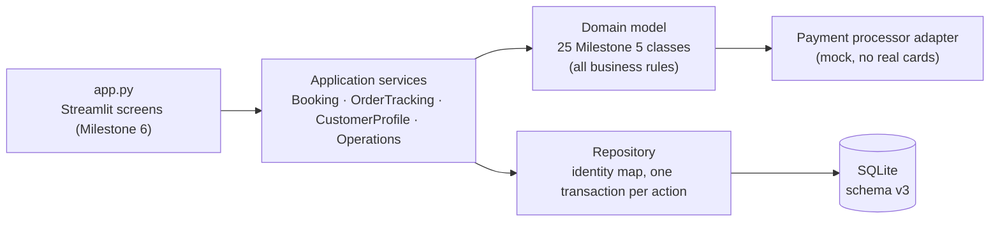

# ZippyWash — Order & Operations Prototype 2

**▶ Live demo: https://zippywash-team5.streamlit.app** (no sign-up; if the app is asleep, click *Wake up* and wait ~30 s)

ZippyWash is a Montréal laundry pickup-and-delivery service. This is **Prototype 2** of its order system,
built by **BTM 495 Team 5** (Concordia University, John Molson School of Business, Fall 2026).

The domain model matches the final **Milestone 5** implementation class diagram: all **25 classes**, every
attribute and every method are implemented. The screens follow the final **Milestone 6** HCI design.

> All people, addresses, cards and prices are **sample data**. No real payments are made.

| | |
|---|---|
| Prototype version | 2.0 |
| Class model | Milestone 5 implementation class diagram (25 classes) |
| Screens | Milestone 6: UC01-SC1, UC02-SC1, UC07-SC2 (with all alternate states) |
| Tests | 165 automated tests, all passing (`pytest`) |
| Visual design | Follows the Milestone 6 wireframes (top bar, five-step progress, cards, status banners) |
| Python | 3.11 or newer (developed on 3.13) |

---

## Set up and run

```bash
python -m venv .venv
source .venv/bin/activate          # Windows: .venv\Scripts\activate
pip install -r requirements.txt
streamlit run app.py               # opens http://localhost:8501
```

On first run the app creates `zippywash.db` from `zippywash/database/schema.sql` and loads the demo data
(`zippywash/database/seed.py`). No database file is shipped. A database left by Prototype 1 (older schema
version) is detected and rebuilt automatically. To use another file, set `ZIPPYWASH_DB=/path/to/file.db`.
*Reset demo data* in the sidebar restores the original sample data.

Run the tests:

```bash
python -m pytest
```

---

## Try the three scenarios (about 3 minutes)

| Scenario | Do this | You'll see |
|---|---|---|
| **UC01-SC1** Book pickup and delivery | As **Léa**: *Book Pickup* → details → *Continue to Time Slots* → *Continue to Review* → *Proceed to Payment*. Pay with **Mastercard 0002**. | **Payment not authorized**: booking not confirmed, no slots reserved. *Retry Payment* with **Visa 4242** → **Booking confirmed** (Scheduled, receipt). **Debit 7777** shows a payment-service timeout. |
| **UC07-SC2** Redeem a reward at checkout | On *Review estimate* → *Apply promotion or reward* → *Use a loyalty reward* → **Free Small Bag** → *Apply Reward*. | **Reserved**: balance 420, reserved 250, available 170; total $34.47 → $5.74 (Small Wash & Fold). Pay with the declined card → **Points restored** (420, back to $34.47). Pay with Visa → **Redeemed** (balance 170, paid $5.74) → confirmation. *Cancel Checkout* also restores the points. |
| **UC02-SC1** View the current order status | *My Orders* → *View Status*. | Latest status, update time and note ("No note available" when empty). Read-only. Switch the sidebar to **Nina** for the **No orders yet** state. |
| Staff (UC02, UC03, UC04) | Sidebar → *Staff*. | Record status changes (role-checked), build / optimize / finalize routes and insert live pickups, report machine faults and repairs, record stock and see low-stock alerts. |

Navigation: **Book Pickup · My Orders · Loyalty / Rewards · Profile**. The sidebar holds demo controls only
(switch customer or staff member, reset the sample data). Order references look like `ZW-20261124-1842`.

---

## How it's built



| Layer | Owns | Never owns |
|---|---|---|
| `app.py` (UI) and `ui_kit.py` (visual components, CSS) | Inputs, which screen is shown, messages, look | Prices, eligibility, status rules, capacity, payment, loyalty |
| `zippywash/services/` | Order of calls for each use case | Business rules, SQL |
| `zippywash/customer_order_service/`, `zippywash/operations_resource/` | The 25 classes, their rules and state changes | Streamlit, SQL |
| `zippywash/database/` | Loading and saving; rebuilding typed relationships | Business decisions |
| `zippywash/integrations/payment_processor.py` | One mock authorization call, refunds | Being a domain class |

Technical helpers (not problem-domain classes): `World`/`Repository`, the services, `PriceBreakdown`,
`LoyaltySummary`, `PaymentOutcome`, `PaymentProcessor`/`MockPaymentProcessor`, the enumerations in `common.py`.

**Relationships are typed.** `order.customer` is a `Customer`, `customer.orders` is a list of `Order`, and so on,
with the Milestone 5 multiplicities. Foreign keys exist only in the database; `zippywash/database/mapping.py`
rebuilds both ends of every relationship on load, and `schema.sql` is generated from that same mapping.

### The four complex methods (Milestone 5 contracts)

| Contract | Method | Behaviour |
|---|---|---|
| M5-C01 | `Order.calculate_estimate()` → `Decimal` | Unit price from `ServiceType.calculate_base_price(bag_size)`, each line once, one promotion **or** one reward (capped), GST + QST on the post-discount amount, stores and returns `estimated_total`. Never confirms, reserves or pays. |
| M5-C02 | `Route.build(route_date, assigned_sector, assigned_vehicle)` | Needs an active sector, an available vehicle and a valid driver shift. One PICKUP and one DELIVERY stop per eligible order, pickup first; capacity counts **orders**, not stops; overflow orders are flagged. Doesn't optimize or finalize. |
| M5-C03 | `Payment.authorize()` → `PaymentStatus` | One processor call at most; AUTHORIZED, FAILED or TIMED_OUT; an invalid method fails without calling the processor. **Does not change its own status**: the service then calls `record_result(result)`. |
| M5-C04 | `LoyaltyAccount.reserve_points(reward, order)` | One posted RESERVATION; `point_balance` unchanged; available = balance − open reservations. Later exactly one of `redeem_points` (after AUTHORIZED) or `restore_points` (failure, timeout, cancellation). |

### Booking transaction order

Review → `Payment.create_attempt(order, order.estimated_total, method)` → `authorize()` → `record_result()`.
Only AUTHORIZED leads to redeeming held points, reserving both time slots and `Order.confirm()` (Scheduled).
A failed or timed-out payment leaves the order unconfirmed, the slots untouched, and restores held points.
If a slot fills up while the customer pays, the payment is refunded and nothing is confirmed.

---

## UML to Python name mapping

The class diagram uses camelCase; Python uses snake_case, one-to-one, with the same parameters.
Examples: `calculateEstimate()` → `calculate_estimate()`, `createAttempt(order, amount, paymentMethod)` →
`create_attempt(order, amount, payment_method)`, `reservePoints(reward, order)` → `reserve_points(reward, order)`,
`finalizeRoute()` → `finalize_route()`, `customerId` → `customer_id`. `tests/model_spec.py` lists the whole
diagram, and `tests/test_model_alignment.py` checks every class, attribute and method signature against it.

| Package | Classes |
|---|---|
| Customer and booking | Customer, Address, ServiceType, TimeSlot, Order, OrderItem, OrderStatusUpdate, Notification |
| Payment and offers | Payment, PaymentMethod, Promotion |
| Loyalty | LoyaltyAccount, LoyaltyRule, LoyaltyTransaction, Reward |
| Operations | StaffMember, StaffShift, Sector, Route, RouteStop, Vehicle |
| Assets and inventory | Machine, MaintenanceRecord, InventoryItem, StockMovement |

**Changes from Prototype 1 (per Milestone 5):** the abstract `Person` class is removed (`name` and
`contact_details` sit on `Customer` and `StaffMember`); `OrderItem.selected_add_ons`, `AddOnType` and the
add-on table are removed; `Payment.create_attempt` takes the amount; payment declines are `FAILED`, with
`TIMED_OUT` added; `TimeSlot` methods take slot counts; every method of every class is now implemented.

---

## Tests

| File | Covers |
|---|---|
| `test_model_alignment.py` | Exactly 25 classes, every attribute, every method and its parameters, typed collections, no `Person` / add-ons, no stub bodies |
| `test_complex_methods.py` | The four contracts, including the reference loyalty case (420 → 250 reserved → 170) |
| `test_classes.py` | Every other method: happy path, validation, state and idempotency rules |
| `test_workflows.py` | UC01 success / failed / timed-out / slot-full; UC02 ownership, read-only, empty state; UC07 redeem, restore on failure, restore on cancel; delivery earns points; cancel refunds |
| `test_persistence.py` | Schema matches the mapping, clean initialization, old database rebuilt, full round trip of every class and relationship, Decimal/date/enum values |
| `test_ui.py` | The Milestone 6 screens and their alternate states, driven through Streamlit |

---

## Known limitations (prototype)

- Payments use a mock processor and demo tokens (`tok_decline…` declines, `tok_timeout…` times out).
- Notifications are recorded and marked Sent; no real email or SMS is sent.
- Route optimization is a simple deterministic simulation (grouped by postal area, fixed minutes per stop); there are no live maps.
- Points are earned when an order is delivered (1 point per dollar paid). Prices, rules and capacities in `zippywash/config.py` and the seed are sample settings.
- Everyone using the live link shares one demo database.
