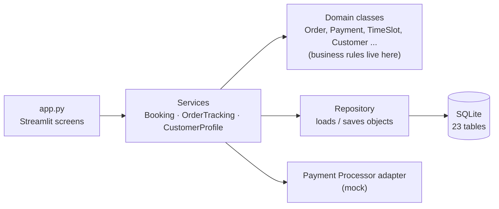
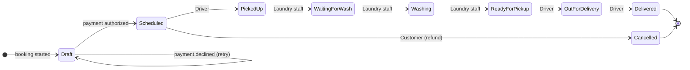

# ZippyWash — Order & Operations Prototype

**▶ Try it live: https://zippywash-team5.streamlit.app** (no sign-up; if it says the app is asleep, click *Wake up* and wait ~30 s)

ZippyWash is a Montréal laundry pickup-and-delivery service. This is the first working prototype
of its order system, built by **BTM 495 Team 5** (Concordia University, John Molson School of Business,
Fall 2026) from our Milestone 3 UML class diagram.

> All people, addresses, cards and prices are **sample data**. No real payments are made.

---

## Try it in 2 minutes

| Step | Do this | You'll see |
|---|---|---|
| 1 | As customer **Léa**, open **Book a pickup**. Pick a service, bag size and times. Enter promo `WELCOME10`. | Live price with promo, delivery fee, GST and QST |
| 2 | Pay with **Mastercard ending 0002** | Declined on purpose. The order is not booked. |
| 3 | Retry with **Visa ending 4242** | Booked, with a receipt number |
| 4 | Open **My orders** | Your order, its receipt and a status timeline |
| 5 | Sidebar → **Staff → Sofia Haddad (Laundry)** | "Mark Picked Up" is disabled: only drivers record pickups |
| 6 | Sidebar → **Staff → Marc Gagnon (Driver)** → mark it *Picked Up* | The status moves one step |
| 7 | Back to **Léa** → *My orders* and *Profile* | Timeline updated, cancel button gone, notification received |

Everyone using the live link shares one database. *Reset demo data* in the sidebar restores the original sample data.

---

## What's covered

| Use case | In this prototype |
|---|---|
| **UC-01** Book Pickup & Delivery | Service, bag size, pickup and delivery address, time slots, confirmation |
| **UC-02** Track & Update Order Status | Customer timeline and history; drivers and laundry staff update status |
| **UC-05** Calculate Price & Process Online Payment | Price breakdown, promo codes, online authorization, declined-card retry, receipt, refund on cancel |
| **UC-06** Manage Customer Profile & Order History | Edit profile, add addresses with service-area check, payment methods, order history, notifications |
| UC-03, UC-04, UC-07 | Planned for Prototype 2. Their database tables already exist. |

---

## How it's built



- **Domain classes** are the classes from our class diagram, with their operations implemented as methods,
  e.g. `Order.calculate_estimate()`, `Order.confirm()`, `Order.update_status()`, `Order.cancel()`,
  `TimeSlot.reserve_capacity()`, `Payment.authorize()`, `Payment.refund()`, `Address.assign_sector()`.
- **Services** only coordinate the classes in the right order. They hold no business rules.
- **The UI** only collects input and shows results.
- **The database** is storage behind a repository, not a class in the domain model.

### Order lifecycle



### Folder map

```
app.py                               Streamlit screens (customer + staff)
zippywash/
  customer_order_service/            C01 Customer · C02 Address · C03 ServiceType · C04 TimeSlot · C06 Order
                                     C07 OrderStatusUpdate · C08 Notification · C11 Payment · C12 PaymentMethod
                                     C14 Promotion
  operations_resource/               C15 Sector · C16 StaffMember
  services/                          BookingService · OrderTrackingService · CustomerProfileService
  integrations/payment_processor.py  External Payment Processor (mock adapter)
  database/schema.sql                All 23 tables from the class diagram
  database/repository.py             Database ⇄ domain objects
  database/seed.py                   Sample data + self-renewing time slots
  config.py                          Prices, fees and tax rates (one place to change them)
tests/test_business_rules.py         14 automated tests, one per business rule
```

Class IDs (C01–C23) match the Milestone 3 class diagram.

---

## Business rules enforced

- An order has one customer, one service type, and a pickup **and** delivery address and time slot.
- Both addresses must belong to the customer and be inside a ZippyWash service sector.
- Pickup can't be in the past; delivery is at least one day after pickup; full slots can't be booked.
- **Payment is authorized before an order is confirmed.** A declined attempt leaves the order as *Draft*; every retry is a new payment record.
- An order uses a promotion **or** a loyalty reward, never both (checked in code and by the database). A discount never exceeds the service price.
- Status moves one step at a time. Drivers record pickup and delivery steps; laundry staff record washing steps; administrators can record any.
- Every status change is kept as history and sends one notification to exactly one recipient.
- An order can be cancelled only before pickup; cancelling frees both slots and refunds the payment.
- Money uses exact decimals, never floating point. Only payment tokens are stored, never card numbers.

---

## Run it on your own computer

Requires Python 3.10 or newer.

```bash
git clone https://github.com/arsalanakbzx/zippywash-prototype.git
cd zippywash-prototype
python3 -m venv .venv
source .venv/bin/activate          # Windows: .venv\Scripts\activate
pip install -r requirements.txt
streamlit run app.py               # opens http://localhost:8501
python -m pytest -q                # runs the 14 business-rule tests
```

The database file `zippywash.db` is created with sample data on first run. Delete it to start over.

---

## Assumptions to confirm

These are placeholders until the team confirms ZippyWash's real values. Change them in `zippywash/config.py`:

- Prices per small bag: Wash & Fold $24.99, Delicates $34.99, Bedding & Linens $39.99; Medium ×1.5, Large ×2
- Delivery fee $4.99; Quebec GST 5% and QST 9.975%
- Delivery at least one day after pickup; cancellation only before pickup
- Service sectors defined by postal-code prefixes (Downtown, Plateau); 3 slots a day, 4 bookings each

---

## Team 5

Nancy Youssef · Lauryn Berenson · Jaden Singh · Arsalan Akbarzadeh · Harry Luong · Yusef Yaafar · Hadi Agha

BTM 495 Information Systems Design and Implementation · Instructor: Amin Ranj Bar · Client sponsor: John Asmar, ZippyWash
